# Masar — Current Entity-Relationship Diagram

Schema after all Flyway migrations **V1–V26** (`backend/src/main/resources/db/migration`). It was read from the PostgreSQL catalog of a database migrated to V26: 25 application tables, plus Flyway's own `flyway_schema_history`, which is not shown.

**How to read it**

- Each table lists only its key columns. `PK` is the primary key, `FK` a foreign key and `UK` a unique key. Mermaid needs a type in front of every column, so a neutral `key` placeholder stands in for the real column types.
- `||--o{` means one parent, any number of children. `|o--o{` means the reference is optional (the foreign key column can be NULL). `||--||` is one-to-one.
- General Requests and Project Tasks (including subtasks and Guest submissions) are the same `requests` table. A Project Task has `project_id` set, and a subtask also has `parent_request_id`.
- Composite foreign keys `(project_id, request_id)` and `(project_id, status_id)` make the database itself keep links, attachments, notifications and statuses inside the same Project. They are listed after the diagram.

```mermaid
erDiagram
    %% ---------- Core ----------
    users {
        key user_id PK
        key email UK
    }
    request_types {
        key type_id PK
        key type_name UK
    }
    projects {
        key project_id PK
    }
    requests {
        key request_id PK "UK with project_id"
        key type_id FK "General Requests"
        key created_by FK "NULL for Guests"
        key assigned_to FK
        key project_id FK "Project Tasks"
        key project_work_type_id FK
        key project_status_id FK "with project_id"
        key parent_request_id FK "subtasks, with project_id"
    }
    comments {
        key comment_id PK
        key request_id FK
        key user_id FK
    }
    status_history {
        key history_id PK
        key request_id FK
        key changed_by FK
        key old_project_status_id FK
        key new_project_status_id FK
        key automation_rule_id FK
    }

    %% ---------- Project configuration ----------
    project_memberships {
        key membership_id PK
        key project_id FK "UK with employee_id"
        key employee_id FK
    }
    project_work_types {
        key work_type_id PK
        key project_id FK
    }
    project_status_columns {
        key status_id PK "UK with project_id"
        key project_id FK
    }
    project_guest_form_settings {
        key project_id PK, FK
        key default_work_type_id FK
    }
    project_guest_fields {
        key guest_field_id PK
        key project_id FK
    }
    project_guest_field_options {
        key option_id PK
        key guest_field_id FK
    }
    project_task_templates {
        key template_id PK
        key project_id FK
        key work_type_id FK
        key created_by FK
    }

    %% ---------- Guests ----------
    request_guest_field_answers {
        key answer_id PK
        key request_id FK "UK with guest_field_id"
        key guest_field_id FK
    }
    guest_communications {
        key communication_id PK
        key request_id FK
        key sent_by FK "NULL for Guest messages"
    }
    guest_tracking_challenges {
        key challenge_id PK
        key request_id FK "NULL when no match"
    }
    guest_tracking_sessions {
        key session_id PK
        key token_digest UK
        key request_id FK
    }

    %% ---------- Task collaboration ----------
    project_task_links {
        key link_id PK
        key project_id FK "UK with source, target, type"
        key source_task_id FK "with project_id"
        key target_task_id FK "with project_id"
        key created_by FK
    }
    task_attachments {
        key attachment_id PK
        key object_key UK
        key project_id FK "with request_id"
        key request_id FK "with project_id"
        key uploaded_by_user_id FK "NULL for Guest uploads"
    }
    task_attachment_visibility_events {
        key visibility_event_id PK
        key attachment_id FK
        key project_id FK "with request_id"
        key request_id FK "with project_id"
        key actor_user_id FK
    }
    user_notifications {
        key notification_id PK
        key recipient_id FK
        key project_id FK
        key request_id FK "with project_id"
        key actor_id FK
        key project_status_id FK
        key automation_rule_id FK
    }

    %% ---------- Workflow (recurring tasks, automation) ----------
    project_recurring_task_rules {
        key rule_id PK
        key project_id FK
        key template_id FK
        key assignee_id FK
        key owner_id FK
        key last_run_request_id FK
    }
    project_recurring_task_occurrences {
        key occurrence_id PK
        key rule_id FK "UK with occurrence_date"
        key request_id FK
    }
    project_automation_rules {
        key rule_id PK
        key project_id FK
        key trigger_status_id FK
        key condition_work_type_id FK
        key action_assignee_id FK
        key action_status_id FK
        key created_by FK
        key last_run_request_id FK
    }
    project_automation_rule_recipients {
        key rule_id PK, FK
        key user_id PK, FK
    }

    %% ---------- Relationships: core ----------
    request_types |o--o{ requests : "types (General)"
    users |o--o{ requests : "creates"
    users |o--o{ requests : "is assigned"
    projects |o--o{ requests : "contains (Project Tasks)"
    project_work_types |o--o{ requests : "classifies"
    project_status_columns |o--o{ requests : "current status"
    requests |o--o{ requests : "parent of (subtasks)"
    requests ||--o{ comments : "has"
    users ||--o{ comments : "writes"
    requests ||--o{ status_history : "has"
    users ||--o{ status_history : "changed by"
    project_status_columns |o--o{ status_history : "old status"
    project_status_columns |o--o{ status_history : "new status"
    project_automation_rules |o--o{ status_history : "changed by rule"

    %% ---------- Relationships: project configuration ----------
    projects ||--o{ project_memberships : "has members"
    users ||--o{ project_memberships : "is member"
    projects ||--o{ project_work_types : "defines"
    projects ||--o{ project_status_columns : "defines"
    projects ||--|| project_guest_form_settings : "guest form settings"
    project_work_types |o--o{ project_guest_form_settings : "default work type"
    projects ||--o{ project_guest_fields : "defines"
    project_guest_fields ||--o{ project_guest_field_options : "offers"
    projects ||--o{ project_task_templates : "defines"
    project_work_types ||--o{ project_task_templates : "used by"
    users ||--o{ project_task_templates : "created by"

    %% ---------- Relationships: guests ----------
    requests ||--o{ request_guest_field_answers : "answers"
    project_guest_fields ||--o{ request_guest_field_answers : "answered in"
    requests ||--o{ guest_communications : "has"
    users |o--o{ guest_communications : "sent by"
    requests |o--o{ guest_tracking_challenges : "verified by"
    requests ||--o{ guest_tracking_sessions : "tracked in"

    %% ---------- Relationships: task collaboration ----------
    projects ||--o{ project_task_links : "contains"
    requests ||--o{ project_task_links : "source"
    requests ||--o{ project_task_links : "target"
    users ||--o{ project_task_links : "created by"
    requests ||--o{ task_attachments : "has"
    users |o--o{ task_attachments : "uploaded by"
    task_attachments ||--o{ task_attachment_visibility_events : "audited by"
    requests ||--o{ task_attachment_visibility_events : "about"
    users ||--o{ task_attachment_visibility_events : "actor"
    users ||--o{ user_notifications : "receives"
    users |o--o{ user_notifications : "acted"
    projects ||--o{ user_notifications : "about project"
    requests ||--o{ user_notifications : "about task"
    project_status_columns |o--o{ user_notifications : "status"
    project_automation_rules |o--o{ user_notifications : "sent by rule"

    %% ---------- Relationships: workflow ----------
    projects ||--o{ project_recurring_task_rules : "defines"
    project_task_templates ||--o{ project_recurring_task_rules : "source template"
    users |o--o{ project_recurring_task_rules : "default assignee"
    users ||--o{ project_recurring_task_rules : "owner"
    requests |o--o{ project_recurring_task_rules : "last created task"
    project_recurring_task_rules ||--o{ project_recurring_task_occurrences : "runs"
    requests |o--o{ project_recurring_task_occurrences : "created task"
    projects ||--o{ project_automation_rules : "defines"
    project_status_columns |o--o{ project_automation_rules : "trigger status"
    project_status_columns |o--o{ project_automation_rules : "target status"
    project_work_types |o--o{ project_automation_rules : "condition"
    users |o--o{ project_automation_rules : "assigns to"
    users ||--o{ project_automation_rules : "created by"
    requests |o--o{ project_automation_rules : "last affected task"
    project_automation_rules ||--o{ project_automation_rule_recipients : "notifies"
    users ||--o{ project_automation_rule_recipients : "is notified"
```

## Composite (same-Project) foreign keys

| Table | Columns | References | Guarantees |
| --- | --- | --- | --- |
| `requests` | `project_id, parent_request_id` | `requests (project_id, request_id)` | A subtask belongs to the same Project as its parent. |
| `requests` | `project_id, project_status_id` | `project_status_columns (project_id, status_id)` | A Task's status column belongs to its own Project. |
| `project_task_links` | `project_id, source_task_id` and `project_id, target_task_id` | `requests (project_id, request_id)` | Linked work items stay inside one Project. |
| `task_attachments` | `project_id, request_id` | `requests (project_id, request_id)` | Attachments belong to a Task of that Project. |
| `task_attachment_visibility_events` | `project_id, request_id` | `requests (project_id, request_id)` | Audit events match the attachment's Task. |
| `user_notifications` | `project_id, request_id` | `requests (project_id, request_id)` | A notification points to a Task of its Project. |

## On-delete behaviour

| Rule | Foreign keys |
| --- | --- |
| **CASCADE** (child rows are removed with the parent) | `user_notifications` → projects, recipient user and Task; `project_recurring_task_rules` → project and template; `project_recurring_task_occurrences` → rule; `project_automation_rules` → project, trigger status and condition Work Type; `project_automation_rule_recipients` → rule and user |
| **SET NULL** (reference cleared, row kept) | `status_history.automation_rule_id`; `user_notifications.actor_id`, `.project_status_id`, `.automation_rule_id`; `project_recurring_task_rules.assignee_id`, `.last_run_request_id`; `project_recurring_task_occurrences.request_id`; `project_automation_rules.action_assignee_id`, `.action_status_id`, `.last_run_request_id` |
| **RESTRICT** (parent cannot be deleted while referenced) | `requests` → projects, Work Types, status columns and parent Task; `comments`, `status_history`, `request_guest_field_answers`, `guest_tracking_*` → requests; `status_history` → old and new status columns; all Project configuration → projects; `project_task_links`, `task_attachments`, `task_attachment_visibility_events`, `project_task_templates`; `project_memberships`; `project_recurring_task_rules.owner_id`; `project_automation_rules.created_by` |
| **NO ACTION** (checked at the end of the statement) | `requests.type_id`, `.created_by`, `.assigned_to`; `comments.user_id`; `status_history.changed_by`; `guest_communications` |

Permanent Task deletion and Project deletion therefore remove dependent rows explicitly in the application, in a fixed order, before deleting the Task or Project.

## Migration map

| Migrations | Tables introduced or extended |
| --- | --- |
| V1–V4 | `users`, `request_types`, `requests`, `comments`, `status_history` (and seed data) |
| V5–V9 | `projects`, `project_memberships`, Project and Guest columns on `requests`, `guest_communications` |
| V10–V14 | `project_work_types`, `project_guest_form_settings`, `project_guest_fields`, `project_guest_field_options`, `request_guest_field_answers`, `project_status_columns`, `guest_tracking_challenges`, `guest_tracking_sessions` |
| V15–V18 | completion setting on status columns, subtasks (`parent_request_id`), `project_task_links`, rich descriptions |
| V19–V21 | `task_attachments`, `task_attachment_visibility_events` |
| V22–V23 | Task dates, `project_task_templates` |
| V24–V25 | `user_notifications` |
| V26 | `project_recurring_task_rules`, `project_recurring_task_occurrences`, `project_automation_rules`, `project_automation_rule_recipients`; automation columns on `status_history` and `user_notifications` |
